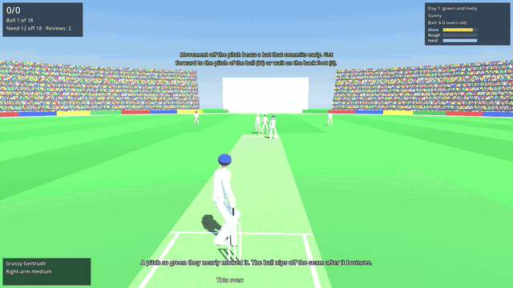

# Silly Point

**A 3D batting game about all the strange things a cricket ball does.**



**[Play in your browser](https://ahab94.github.io/silly-point/)** (desktop or phone) · [Downloads for Windows, macOS and Linux](https://github.com/ahab94/silly-point/releases/latest) · If you enjoy it, a ⭐ helps a lot.

Install with one command:

```bash
curl -fsSL https://raw.githubusercontent.com/ahab94/silly-point/main/install.sh | bash
```

On Windows (PowerShell): `irm https://raw.githubusercontent.com/ahab94/silly-point/main/install.ps1 | iex`

New balls swing. Old balls reverse. Green pitches seam, Day 5 pitches crack, footmarks turn square, dew turns the ball into soap. You have one bat, a sense of timing, and a review you probably shouldn't waste.

Built in Godot 4.7 (GDScript) with the Compatibility renderer, so it runs in the browser. Everything is drawn and synthesized in code.

## How to play

Controls are in the Cricket 07 style: hold a direction, press a shot key as the ball arrives.

| Action | Keyboard | Touch |
|---|---|---|
| Direction and footwork | W A S D or arrow keys (8-way) | left stick |
| Defend | J (or Space / Z) | BLOCK |
| Ground shot | K (or X) | HIT |
| Lofted shot | L (or C) | LOFT |
| Sweep | I (or V) | SWEEP |
| Leave | press nothing | press nothing |
| Charge down the pitch | Shift (just after release) | CHARGE |
| Switch camera (behind the batter or TV view) | C | CAM |
| Review an out decision | R | Review button |
| Menu | Esc | Menu button |

**Direction is footwork.** Up (towards the bowler) is the front foot, down is the back foot, and left/right pick the leg or off side. Pure left or right aims squarer. So W+D is a cover drive, W is a straight drive, W+A is a flick, S+D is a cut, S+A is a pull, and S+A with L is a hook.

**You watch the whole delivery.** Pressing a shot key starts your swing, which takes about 0.2 s to reach the ball. Your bat lines up with where the ball *seems* to be heading at that moment:
- **Press early:** whatever the ball does afterwards (late swing, seam, a crack, the googly) finds the edge.
- **Press late:** you're beaten for pace.
- **Footwork:** getting forward to the pitch of the ball smothers the movement, and going back gives you longer to see it.

**Play with the movement.** Aim your shot the way the ball is moving and the bat face covers it: flick the inswinger or the off-break, drive the outswinger or the leg-break. Play across it and the margin shrinks.

## The quirks

| Quirk | What it does in the game |
|---|---|
| Ball age | Shine falls over the overs. On a dry, abrasive square one side roughens from about 20 overs. The ball softens: less bounce, less off the bat. Meters show all three. |
| Conventional swing | A shiny ball swings away from the shiny side. Overcast skies help. |
| Reverse swing | An old, rough ball bowled at 135+ kph swings towards the shiny side. The meter says REVERSING. |
| The ball cam | At release you see the ball in the hand: the seam angle and the shiny side (pace), or the spin direction (spin). Read it. |
| Pitch age | Day 1 is green (seam movement, bounce). Days 2–3 are flat. Day 4 brings cracks and footmarks, and Day 5 crumbles: variable bounce and big turn. |
| Cracks | Some balls shoot along the ground or spit up off a length. |
| Footmarks | Rough patches outside the stumps grip extra for spinners. |
| Dew | The ball is wet: no swing, no grip for spinners, and it skids on. |
| Deliveries | Outswinger, inswinger, seamer, off- and leg-cutters, slower ball, yorker, bouncer, off-break, arm ball, "the other one", leg-break, googly, top-spinner, flipper. |
| Driving on the up | Driving a good-length ball goes in the air. Drive the full ones. |
| LBW | Pitched outside leg is not out. Hit outside off while playing a shot is not out. Leave it and that protection is gone. Too far down the pitch, and the umpire won't give it. |
| Reviews | Two per innings, and you keep a successful one. "Pigeon-Eye" ball tracking shows pitching, impact and wickets, with umpire's call when the ball only clips the stumps. The "Snick-o-Scope" finds faint edges. The fielding side reviews too. |
| Free hit | A no-ball in a T20 means the next ball is a free hit. |
| Odd dismissals | Played on, hit wicket going back to a bouncer, stumped after charging a spinner who saw you coming. |
| Fielding | Catches at any height, diving stops and misfields, and runs depend on where the ball is fielded and the throw. Field settings change with the bowler. |

## Career

Ten match situations. Each one introduces one quirk.

1. **Net Session**: timing and direction against gentle medium pace.
2. **The New Ball**: Day 1, overcast, shiny ball. Survive.
3. **Green Top**: seam movement off the pitch.
4. **Chin Music**: bouncers. Pull, hook or duck.
5. **Tweak Week**: Day 4 off-spin, footmarks, charging and sweeping.
6. **The Wizard of Wrist**: leg-spin with the googly, top-spinner and flipper.
7. **Old Ball, New Tricks**: reverse swing at over 52.
8. **Dew Drop Inn**: a night T20 chase with dew and free hits.
9. **Day Five Dust Bowl**: survive four overs of spin on a crumbling pitch.
10. **The Second New Ball**: reverse swing, then the new ball arrives mid-chase.

Stars: in a chase, ★ for winning, ★★ for losing no wickets, and ★★★ for no wickets with an over to spare. In a survival match, stars come from runs scored while surviving.

## How it works

- **Deterministic physics** (`scripts/ball_sim.gd`).
  - A delivery is a set of numbers: speed, target spot, swing, drift, deviation off the pitch, bounce and skid. They are integrated at 240 Hz into a trajectory.
  - The game, the autopilot and the ball-tracking replay all read the same trajectory.
- **Conditions** (`scripts/conditions.gd`) turn ball age, pitch day, weather and dew into how much the ball swings, seams, turns and bounces.
- **Batting** (`scripts/batting.gd`) turns a key press into a result:
  - timing error;
  - bat placement versus where the ball really is (edges, misses, the middle);
  - shot suitability: driving on the up, cutting a ball too close to you, sweeping the quicks.
- **Rules** (`scripts/rules.gd`): fielding, LBW and the review system decide each ball.
- **Autopilot**: an expert bot tries every shot on the real trajectory, and must win every match (the "winnable" gate).
- **Rookie bot**: a flawed bot with sloppy timing that can't see late movement. It measures the difficulty curve. Win rates at skill 0.6 fall from about 80% in match 1 to about 25% in match 10.

## Roadmap

- [x] v0.1 prototype:
  - 3D ground, physics, all the quirks above, 14 delivery types, 8 bowlers and 10 matches;
  - reviews with ball tracking and the edge detector;
  - fielding, commentary, synthesized sound, touch controls;
  - expert autopilot gate, rookie difficulty curve and headless tests.
- [ ] Play-test with the user, then tune timing windows and shot feel.
- [ ] Better batter animation: proper strokes, a shot preview arrow, replays of wickets and sixes.
- [ ] Running between the wickets: call for a risky extra run, with run-outs.
- [ ] Quick play: pick the day, ball age, weather and bowler.
- [ ] Music, more crowd reactions, a duck animation for getting out for 0.
- [x] GitHub repo, release workflow, browser build on Pages, one-line installers.
- [ ] Portrait mode for Shorts and phones held upright.

## Development

See [CLAUDE.md](CLAUDE.md) for the commands, dev flags and project layout.
